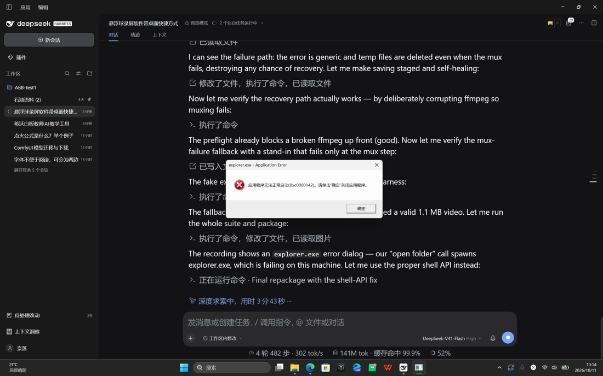

# 屏录球 · Screen Recorder Floating Ball

> 一个 Windows 桌面录屏小工具：桌面上一个半透明**悬浮球**，点一下开始录制屏幕（含系统声音 / 麦克风），
> 再点一下停止并保存为标准 **MP4（H.264 + AAC）**。
> 无需安装，自带编码器，纯 C# / WPF 编写，不依赖任何 NuGet 包。

[English summary](#english-summary) · [快速开始](#一快速开始) · [常见问题](#七常见问题) · [实现要点](#九实现要点给后续维护者)



*(上图是从本工具录制的视频里抽的一帧，右下角能看到悬浮球本体)*

---

## 特性

- **悬浮球一键录制**：单击开始/停止，双击打开设置，右键弹出完整菜单，可随意拖动位置（会记住）
- **声音**：系统声音（WASAPI 回环）+ 麦克风，可分别调音量、可只用其中一个、也可以不录
- **录制区域**：主显示器 / 所有显示器（虚拟桌面拼接）/ 指定显示器 / **鼠标框选任意区域**
- **输出即 MP4**：H.264（libx264）+ AAC-LC 48 kHz 立体声，带 `+faststart`，可直接拖进浏览器、微信、剪辑软件
- **音画同步**：以同一条单调时钟推进，暂停/继续、卡顿都不会让声音画面错位
- **全局快捷键**：`Ctrl+Alt+R` 开始/停止，`Ctrl+Alt+P` 暂停/继续
- **托盘图标** + 录制计时气泡 + 开始/停止提示音
- **抗异常**：保存流程分级回退（混流失败也会存出画面）、启动前预检目录与编码器、停止录制不卡界面

## 系统要求

| 项目 | 要求 |
| --- | --- |
| 操作系统 | Windows 10 1809（build 17763）或更高 / Windows 11 |
| 运行时 | .NET 10 桌面运行时（仅运行发布版；自行编译需要 .NET 10 SDK） |
| 编码器 | `ffmpeg.exe`（**未随本仓库提供**，见下方「准备 ffmpeg」） |
| 显卡 | 无要求（抓屏走 GDI，不依赖 GPU） |

---

## 一、快速开始

### 1. 准备 ffmpeg

本仓库**不包含 ffmpeg.exe**（体积 60+ MB，且分发需遵守其许可证）。请任选一种方式准备：

```powershell
# 方式 A：winget（推荐）
winget install Gyan.FFmpeg

# 方式 B：scoop
scoop install ffmpeg

# 方式 C：手动下载 https://www.gyan.dev/ffmpeg/builds/ 的解压包，
#         把 bin\ffmpeg.exe 放到下面任意一个位置：
#           <程序目录>\ffmpeg.exe
#           <程序目录>\ffmpeg\ffmpeg.exe
#           tools\ffmpeg\ffmpeg.exe      ← 仓库里预留了这个目录
```

程序启动时会依次在这些位置以及系统 `PATH` 中查找 `ffmpeg.exe`，并在日志里写明用的是哪一个。
**找不到时会直接提示，不会静默失败。**

### 2. 运行

```powershell
# 自行编译（需要 .NET 10 SDK）
git clone <你的仓库地址>
cd ScreenRecorder

# 把 ffmpeg 放到 tools\ffmpeg\ 下（见上），然后一键打包到 dist\屏录球\
powershell -ExecutionPolicy Bypass -File tools\build.ps1
```

打包产物在 `dist\屏录球\`，直接双击 `屏录球.exe` 即可，**无需安装**。

> 打包脚本会顺便在桌面创建快捷方式。如果桌面不可写，也可以在程序里右键悬浮球 →「创建桌面快捷方式」。

### 3. 用法

| 操作 | 效果 |
| --- | --- |
| **单击**悬浮球 | 开始 / 停止录制（暂停状态下为继续） |
| **双击**悬浮球 | 打开设置 |
| **右键**悬浮球 | 开始录制 / 暂停继续 / 设置 / 打开文件夹 / 创建桌面快捷方式 / 退出 |
| **按住拖动** | 移动悬浮球位置（会记住，多显示器也支持） |
| `Ctrl + Alt + R` | 开始 / 停止录制 |
| `Ctrl + Alt + P` | 暂停 / 继续 |

录制中悬浮球变红并有呼吸光环，上方显示 `00:12` 计时气泡；暂停时变黄并显示暂停符号。

---

## 二、设置项

双击悬浮球打开设置：

- **录制区域**：主显示器 / 所有显示器 / 指定显示器 / 自定义区域（点「框选区域」，屏幕变暗后拖拽框选）
- **声音**：系统+麦克风 / 仅系统 / 仅麦克风 / 不录音；两路音量 0–150%；可指定麦克风设备
- **画质**：帧率 15/20/24/25/30/45/60；清晰度 4 / 8 / 12 / 20 Mbps
- **保存位置**：默认 `我的视频\屏录球`，可改成任意目录
- **其他**：录完自动打开文件夹（并选中该文件）、开始/停止提示音、托盘图标、悬浮球大小

设置保存在 `%LOCALAPPDATA%\ScreenRecorder\settings.json`（该目录不可写时自动退回程序目录）。
日志在程序目录下 `logs\app.log`。

---

## 三、输出文件

- 文件名：`录屏_年月日_时分秒_毫秒.mp4`
- 编码：视频 **H.264 (libx264, yuv420p)**，音频 **AAC-LC 48 kHz 立体声**
- 已写入 `+faststart`，适合直接播放与上传

---

## 四、项目结构

```
ScreenRecorder/
├─ src/ScreenRecorder/                 主程序（WPF + 原生 Win32 互操作，无 NuGet 依赖）
│  ├─ EntryPoint.cs                    入口：命令行自检 / 单实例 / 启动悬浮球 / 创建快捷方式
│  ├─ Capture/
│  │  ├─ GdiScreenCapture.cs           抓屏：GetDC + CreateDIBSection + BitBlt
│  │  ├─ ScreenCapture.cs              抓屏统一入口与帧结构
│  │  ├─ RecordingEngine.cs            录制引擎：时间轴、音画同步、暂停、混音、落盘
│  │  ├─ ScreenHelper.cs               显示器枚举 / 虚拟桌面范围
│  │  ├─ Audio/WasapiInterop.cs        WASAPI 原生互操作声明
│  │  ├─ Audio/WasapiAudioCapture.cs   系统回环 + 麦克风采集、重采样、混音
│  │  └─ Encoding/FFmpegRecorder.cs    ffmpeg 实时编码 + 分级回退封装
│  ├─ UI/                              悬浮球 / 设置 / 框选区域 / 托盘 / 全局快捷键
│  ├─ Shell/                           设置持久化、日志、快捷方式
│  ├─ SelfTest/                        命令行自检（录制 / 抓屏 / 交互 / 保存 / 渲染）
│  └─ Assets/app.ico                   程序图标（多尺寸）
├─ tools/
│  ├─ build.ps1                        一键构建 + 打包到 dist
│  ├─ make-icon.ps1                    用纯 .NET 生成多尺寸 ico
│  └─ ffmpeg/                          预留：把 ffmpeg.exe 放这里（不纳入版本管理）
├─ docs/images/                        文档用截图
├─ 更新屏录球.cmd                       日常重建后把产物拷进 dist
└─ README.md
```

---

## 五、开发者：构建与自检

```powershell
# 构建
dotnet build src\ScreenRecorder\ScreenRecorder.csproj -c Release

# 一键打包（含复制 ffmpeg、创建桌面快捷方式）
powershell -ExecutionPolicy Bypass -File tools\build.ps1
```

程序内置了**无界面自检**，用来验证录制链路而不是"看起来能跑"：

```powershell
$exe = "src\ScreenRecorder\bin\Release\net10.0-windows\屏录球.exe"

# 真实录 6 秒并生成 MP4，打印时长 / 大小 / 帧数
& $exe --selftest --seconds=6 --audio=both --out=D:\tmp

# 抓屏链路：抓一帧存成 BMP 并统计亮度（确认不是黑屏）
& $exe --capturetest

# 悬浮球交互：事件绑定 / 单击开始 / 拖动位移 / 能否停下来
& $exe --interacttest

# 停止响应：测量 Stop() 耗时，防"点停止后界面卡死"回归
& $exe --stoptest --seconds=6

# 保存链路：含音轨 / 无音轨两条路径，校验文件非空且是合法 MP4
& $exe --savetest

# 界面渲染：把悬浮球三种外观渲染成 PNG
& $exe --uitest
```

全部自检项的完整参数：

| 参数 | 说明 |
| --- | --- |
| `--selftest [秒数]` | 无界面录制自检 |
| `--area=primary\|full` | 自检录制区域 |
| `--audio=both\|system\|mic\|none` | 自检音频来源 |
| `--out=目录` | 自检输出目录 |
| `--capturetest` | 抓屏链路自检 |
| `--interacttest` | 悬浮球交互自检 |
| `--stoptest [秒数]` | 停止响应自检 |
| `--savetest` | 保存链路自检 |
| `--uitest` | 悬浮球界面渲染自检 |

### 实测数据（2560×1600 @150% 缩放，Windows 11）

```
--selftest    时长=00:06  大小=2.74 MB  帧数=183        H.264 2560x1600@30fps + AAC 48kHz 立体声
--stoptest    Stop() 用时 203 ms，文件 2.04 MB，153 帧
--savetest    [含音轨] 1117807 字节 / [无音轨] 1060623 字节，临时残留 0
--interacttest 路由事件被处理 down=True up=True；拖动位移 152,106 px（与鼠标 1:1）
```

---

## 六、技术选型说明

| 决策 | 原因 |
| --- | --- |
| **不用 NuGet 包** | WinRT 投影包在离线环境无法还原；改用原生 COM 互操作直接调用 WASAPI 与系统接口，产物更小、启动更快 |
| **抓屏用 GDI BitBlt** | `Windows.Graphics.Capture` 在远程桌面、部分虚拟显示驱动、受策略限制的会话中会返回 `E_ACCESSDENIED`；GDI 在这些场景下依然可用。配合 `CreateDIBSection` 直接拿到像素内存，避免 `GetDIBits` 在某些驱动上返回全黑 |
| **编码交给 ffmpeg** | 省掉自己维护 MP4 封装 + 码率控制；`libx264 -preset veryfast -tune zerolatency` 在 1080p/1440p 实时录屏下 CPU 占用可控 |
| **两阶段保存** | 录制中只把 BGRA 帧写进 ffmpeg 的 stdin（H.264 先编码到临时文件），音频 PCM 攒在内存；停止时再写 WAV 并用同一次 ffmpeg 调用混流。只用一个外部进程，音画天然同步，也避免双管道争用 |
| **独立写线程 + 有界队列** | 管道写会在编码器跟不上时阻塞；放到独立线程后，录制主循环与停止流程都不会被卡住（最多丢最旧的 3 帧） |

---

## 七、常见问题

**Q：提示找不到 ffmpeg.exe？**
见「快速开始 → 准备 ffmpeg」。程序会依次在程序目录、`ffmpeg\`、`tools\ffmpeg\`、`PATH` 里找。

**Q：录制文件很大 / 很小？**
在设置里调「清晰度」。屏幕内容剧烈变化（看视频、滚动页面）时码率会明显上升，这是 H.264 的正常行为。

**Q：实际帧率低于设置值？**
抓屏与编码都按设置帧率驱动；CPU 吃紧时会丢帧。可降低帧率或缩小录制区域。

**Q：为什么抓屏走的是 GDI 而不是系统图形捕获？**
`Windows.Graphics.Capture` 在当前会话被系统拒绝时会自动回退到 GDI BitBlt，功能不受影响，日志里会写明走了哪条路。

**Q：保存出来是空文件 / 提示"输出文件不完整"？**
0.1.0 之后的版本做了三级回退：混流成功用带音轨的文件 → 混流失败则落盘为「仅画面」MP4 → 都失败才报错并保留临时文件。
另外**录制时长不足 1.5 秒**时本来就可能来不及产出有效文件，请录久一点再停止。
若仍失败，把 `logs\app.log` 里的「视频编码结束」「混流」「保存成功」三段发出来即可定位。

**Q：悬浮球会录进画面里吗？**
会。想避免的话，开始录制前把它拖到不想录的区域之外，或缩小录制区域绕过它。

**Q：想开机自启？**
把桌面快捷方式复制到 `shell:startup` 目录即可。

---

## 八、已知限制

- 只有 Windows 版本，且依赖 .NET 10 桌面运行时
- 悬浮球本身会被录进画面（没有做窗口排除）
- 抓屏走 GDI，帧率上限受 CPU 影响；4K 高帧率场景建议缩小区域
- 不包含 ffmpeg.exe，需要自行准备
- 录制中没有实时预览窗口

---

## 九、实现要点（给后续维护者）

- **抓屏**：`GetDC(NULL)` → `CreateCompatibleDC` → `CreateDIBSection`（让 GDI 自己分配像素内存）→ 每帧 `BitBlt` → 拷回托管数组。
  用 GDI 自己的内存而不是 pin 托管数组，是为了避开 `CreateDIBSection` 对托管数组地址的要求（曾出现画面全黑）。
- **音频**：WASAPI 事件驱动；系统回环用 `AUDCLNT_STREAMFLAGS_LOOPBACK`，麦克风走 capture 端点；
  设备混音格式多样（例如 192 kHz float 立体声），统一重采样成 16 bit / 48 kHz / 立体声后按采样计数混音。
- **音画同步**：以 `Stopwatch` 为唯一时间轴；视频按 `1000/fps` 分槽，音频按目标采样数推进；
  某刻缺数据就补静音 / 重复上一帧，因此暂停、卡顿都不会让声画错位。
- **拖动悬浮球**：用 `GetCursorPos` + `GetWindowRect` 记录按下时的物理像素位置，移动时 `SetWindowPos` 直接定位；
  阈值按物理像素 × DPI 缩放计算。**不要**用 `PointToScreen` 的差值去改 `Window.Left/Top`（DIP 与物理像素混用，高 DPI 下会漂移，且会把单击误判成拖动）。
- **WPF 启动**：不要同时保留 `App.xaml` 生成的入口点和自定义 `Main`，
  否则会在 `InitializeComponent()` 里抛出"无法创建第二个 Application 实例"。本项目直接删掉了 `App.xaml`，
  入口在 `EntryPoint.cs`，需要主题资源时用 pack URI 加载。

### 踩过的坑（避免重复）

1. **XAML 里必须显式绑定鼠标事件**：只写处理方法不会生效，窗口看起来正常但完全没有交互。
   现在有 `--interacttest` 专门守着这一点。
2. **保存收尾要分级回退**：混流失败时 ffmpeg 会留下一个 0 字节的目标文件，
   若此时清理掉临时视频，就会"什么都没留下"。见第七节。
3. **停止录制不能等管道写**：录制主循环直接写管道会在编码器跟不上时阻塞，
   `Stop()` 再 `Join` 就会卡界面。现在先 `AbortPipe()` 让阻塞的写立刻返回。

---

## 十、许可证

本仓库代码以 MIT 许可证发布，见 [LICENSE](LICENSE)。

**注意**：程序运行依赖的 `ffmpeg`（若你按其许可证分发）需遵守 **LGPL / GPL**；
常见的 `ffmpeg-gpl` 构建因启用 libx264 属于 **GPL**。本仓库不附带 ffmpeg 二进制，
使用者自行获取，请自行确认许可合规。

---

## English summary

**Screen Recorder Floating Ball** — a tiny Windows screen recorder with an on-screen translucent
floating ball. One click starts/stops recording of the screen plus system audio and/or microphone,
producing a standard MP4 (H.264 + AAC). Written in pure C#/WPF with native Win32 interop and
**no NuGet dependencies**; encoding is delegated to a `ffmpeg` binary that you supply yourself.

- Click the ball to start/stop, double-click for settings, right-click for the full menu, drag to move
- Region selection, multi-monitor, per-source volume, 15–60 fps, 4–20 Mbps
- Global hotkeys `Ctrl+Alt+R` (start/stop) and `Ctrl+Alt+P` (pause/resume)
- Built-in headless self-tests: `--selftest`, `--capturetest`, `--interacttest`, `--stoptest`, `--savetest`, `--uitest`

Build: `powershell -File tools\build.ps1` (requires .NET 10 SDK; put `ffmpeg.exe` in `tools\ffmpeg\` first).
